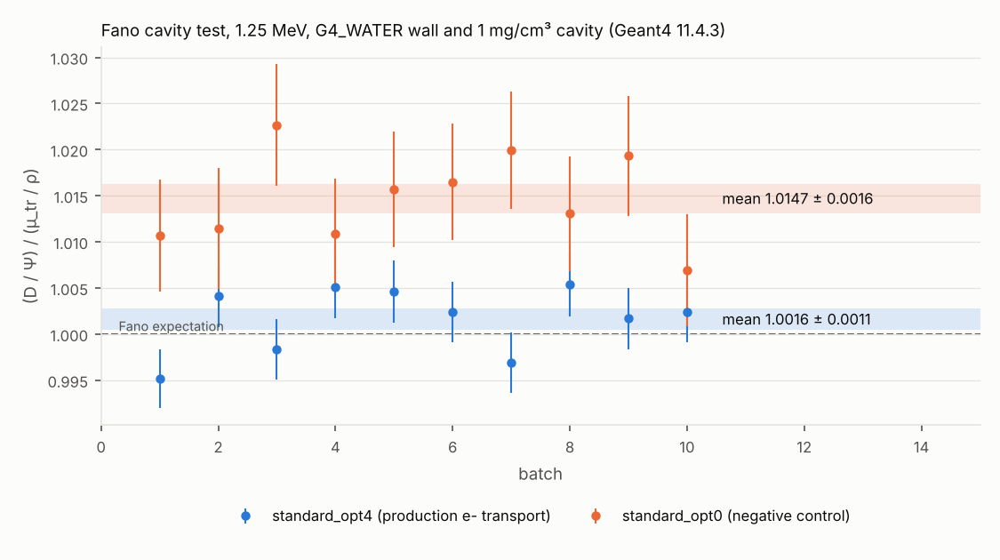

# Status

## M1. Monte Carlo reference at R0 (2026-10-10). Reviewed at the gate; decisions D024–D026. One approved extension run in progress.

### Summary

The Geant4 reference for all five layers at R0 is done: G4EmStandardPhysics_option4, 10 keV thresholds, 2.4 × 10⁸ histories in 20 batches (main run and a seed-independent replicate, pooled by the rule fixed in advance, D022). Every statistical target in plan Section 4.1 is met.

- **Dose.** D/Φ₀ = 5.3713 × 10⁻¹² Gy cm² ± 0.087%. This is the boundary-free value, adopted under D025/D027; the scoring cylinder gives 5.3584 × 10⁻¹² ± 0.066%, 0.24% lower.
- **β.** β = D/K_col = 1.0069 ± 0.0011 with the boundary-free D (1.0045 ± 0.0006 with the cylinder D).
- **s_w,air.** Scoring reference (D024): ICRU 90 basis, with ICRU 37 alongside. The Spencer–Attix ratio (Δ = 10 keV) is 1.1331 on the ICRU 37 stopping-power basis, 1.1268 on ICRU 90 and 1.1385 on Geant4's own stopping powers. The 1% spread between bases is far larger than the statistics.

Problems found and fixed or bounded:
- **Two Geant4 problems that would have biased results (fixed).** Rayleigh scattering of primaries is missing in option4's general gamma process (D019). The plan's linear track-length estimator gives the wrong electron fluence at low energy (D020).
- **10-batch standard errors can come out much too small by chance (D023).** This made a primary-fluence fluctuation in the main run look like a 4σ effect; the replicate resolved it.
- **The scoring cylinder's boundary distorts the dose by up to ±3% in the few millimetres next to it and lowers it by 0.24% inside.** After the 20-batch extension, the cylinder dose is 0.99759 ± 0.00109 of the boundary-free dose (−2.2σ). By the rule in D025, with the threshold set in D027, the boundary-free value is now the R0 dose reference. M2 re-measures it with boundary-free scoring.

Results page: `analysis/results/co60_r0_m1.html`, published (private) at https://claude.ai/artifact/Cu5ScfiTccG3u14D4mbiLe. Study brief (why, what, results, strengths and weaknesses, venues): `analysis/results/co60_brief.html` (built by `analysis/m1_brief.py`), published (private) at https://claude.ai/artifact/24vAALYwGGg9Hej4P7Df4d.

### What was done

**Application** (`mc/geant4/co60app/`). A Geant4 11.4.3 application scoring the five layers in the R0 geometry:
- point source at SSD 100 cm, uniform in solid angle over the 10 × 10 cm² pyramid, both lines with equal probability;
- 30 cm water cube, scoring cylinder r = 1 cm, t = 0.2 cm centred at 5 cm depth;
- production thresholds set by energy (10 keV for e−/e+ in G4_WATER, range 8.25 µm);
- every photon carries its history: primary per line, scattered source photon, or secondary photon. Every electron carries its parent photon's category and whether it is a delta ray;
- tallies in MeV, cm and g; JSON output per batch; per-history second moments for D, K and the total photon track length.

**Variance reduction** (D016). Electron Russian roulette outside a region of interest, and photon importance sampling in a parallel world (importance 2, 8, 32). The efficiency gain for D is about 25× over analog transport. An analog run checks it (below).

**Runs** (`mc/runs/`, each with a manifest):

| Run | Purpose | Histories |
|---|---|---|
| M1-R0-option4, M1-R0-option4-rep2 | main run and replicate, pooled (D022) | 2 × 10 × 1.2 × 10⁷ |
| M1-R0-option4-S2-5keV | check S2: 5 keV thresholds | 10 × 6 × 10⁶ |
| M1-R0-option4-S1-half | check S1: r 0.5 cm, t 0.1 cm | 10 × 9 × 10⁶ |
| M1-R0-option4-pdd | central-axis depth dose, PDD(5) | 10 × 6 × 10⁶ |
| M1-vrcheck-analog | no variance reduction | 10 × 6 × 10⁶ |
| M1-thinslab-option4-v2 | thin-slab track-length test | 10 × 4 × 10⁵ |
| M1-check-transmission | tracking μ by transmission (TestEm13) | 2 × 2 × 10⁷ photons |
| M1-check-primary-* | primary-fluence diagnostics (5 runs) | see below |
| M1-check-pdd-cyl8 | depth scan with the cylinder at 8 cm | 4 × 3 × 10⁶ |
| M1-check-boundary-free-R0, -ext | boundary-free dose at R0 (main VR, cylinder at 8 cm) | 10 × 6 × 10⁶ + 20 × 6 × 10⁶ |
| M1-tables-option4-v2 | stopping powers, δ, cross sections from the production physics | — |

Compute ran in this 4-core container (D013). Wall times per batch are in each manifest; runs often shared the CPU, so they overstate CPU use.

### Results at R0 (pooled, 20 batches)

Uncertainties are 1σ standard errors of the mean: the larger of the batch spread and the history-by-history estimate where both exist (D023).

| Layer | Quantity | Value |
|---|---|---|
| 1 | total photon fluence / Φ₀ | 1.1541 ± 0.0004 |
| 1 | scattered fraction of fluence / of energy fluence | 0.3685 / 0.1810 |
| 1 | mean photon energy, all / scattered | 0.9666 / 0.4747 MeV |
| 2 | interactions: Compton, photoelectric, Rayleigh, pair | 96.52%, 2.43%, 1.03%, 0.020% |
| 2 | share of energy transferred by Compton | 99.77% |
| 3 | mean initial electron energy: all / primary parent / scattered parent | 0.3472 / 0.5887 / 0.1263 MeV |
| 3 | Compton recoils above the free-electron edge (1.1732 / 1.3325 MeV) | 0.22% / 0.18% |
| 4 | delta-ray share of electron fluence above 10 keV | 0.0300 |
| 4 | radiative / collision energy loss | 0.00229 |
| 5 | D/Φ₀, R0 reference (boundary-free, D027) | 5.3713 × 10⁻¹² Gy cm² ± 0.087% |
| 5 | D/Φ₀ in the scoring cylinder | 5.35838 × 10⁻¹² Gy cm² ± 0.066% |
| 5 | K/Φ₀, K_col/Φ₀ | 5.3483, 5.3343 × 10⁻¹² Gy cm² |
| 5 | β = D/K_col, boundary-free D (cylinder D) | 1.0069 ± 0.0011 (1.0045 ± 0.0006) |
| 5 | g | 0.00262 |
| 5 | dose from electrons set in motion by scattered photons | 18.8% |
| 5 | s_w,air (Spencer–Attix, Δ = 10 keV): ICRU 37 / ICRU 90 / Geant4 / PEGS4 matched | 1.1331 / 1.1268 / 1.1385 / 1.1259 |
| 5 | PDD(5), d_max | 81.53 ± 0.26%, 0.78 ± 0.05 cm |

The ICRU 37-basis s_w,air, 1.1331, agrees with the TRS-398 value in refs.yaml (1.133, not yet verified). PDD(5) has no external value yet; refs.yaml `pdd5` is null. The depth of maximum dose is poorly defined, because the dose is flat to within about 0.5% between 0.45 and 0.95 cm.

### Checks

| Check | Result | Status |
|---|---|---|
| Statistical targets (Section 4.1) | D/Φ₀ 0.066% (target 0.1%), β 0.062% (0.2%), worst spectral bin 0.57% (1%) | met |
| Thin slab: track-length fluence against analytic, no VR | 0.9995 ± 0.0007 | passes |
| Tracking μ against G4EmCalculator (TestEm13 transmission) | +0.10 ± 0.04% (1.1732 MeV), +0.07 ± 0.04% (1.3325 MeV) | measured; the analytic fluence uses tracking μ |
| Primary fluence at R0 against analytic (tracking μ) | pooled 0.9992 ± 0.0004 (−1.7σ); main 0.9988 ± 0.0006, replicate 0.9996 ± 0.0006 | passes |
| Fluence-to-dose closure (CSDA-weighted estimator) | 1.0007; linear estimator 1.0644 (D020) | passes |
| S2: 5 keV thresholds | D/Φ₀ +0.13% (+0.9σ); s_w,air +0.0003%; electron fluence normalization +0.12%, shape χ² 20/24; photon fluence normalization −0.03%, shape χ² 29/26 | passes |
| S1: half-size scoring volume | D/Φ₀ +0.47% (+2.1σ); electron fluence normalization +0.42%, shape χ² 23/24; s_w,air +0.0010% | passes (under 3σ) |
| Analog transport against VR | D/Φ₀ −0.10% (−0.2σ); electron fluence normalization −0.04%, shape χ² 8/22 | passes |
| Scoring-cylinder boundary: D in the cylinder over the boundary-free D at R0 | 0.99759 ± 0.00109 (−2.2σ, 30 boundary-free batches) | boundary effect resolved; boundary-free D adopted (D027) |
| Event sample, validity rules (D014) | 0.064% of 100,000 Monte Carlo interactions fail the bound rules; 99% fail the strict free-electron rules | as designed |
| Bookkeeping | 0 untagged tracks; largest per-interaction energy imbalance 1.23 keV | passes |
| Fano step-size diagnostics | msc range factor 0.04: 1.00001 ± 0.00088 (20 batches; production 1.00157 ± 0.00058); step function 0.05 / 1 µm: running | range factor done; step function pending |

### What failed or was anomalous

- **Rayleigh scattering missing for primaries (fixed, D019).** In option4, G4GammaGeneralProcess does not sample Rayleigh scattering above 1.022 MeV, so primary photons could never scatter coherently. It showed up in the first production attempt as zero Rayleigh events among primaries. That attempt was stopped and archived (`mc/runs/_archived/M1-R0-option4-attempt1/`). All production runs switch the general process off.
- **Plan's linear electron-fluence estimator fails closure (D020).** It puts too much track length at low energy for the final steps of electrons below about 20 keV, so the dose rebuilt from it is 6.4% too high. A CSDA-weighted estimator closes to 0.07% and is the Layer 4 reference. The linear one is kept and reported; on s_w,air the two differ by 0.008%.
- **Photon categories wrong at importance-cell boundaries (fixed before production).** Split copies were labelled as secondary photons, and primaries became "scattered" when crossing a cell boundary. Interactions are now counted only for electromagnetic processes, and split copies inherit the parent's history. Every production run reports 0 untagged tracks.
- **The scoring cylinder's boundary distorts the dose next to it.** The PDD run's 1 mm depth slabs (r < 1 cm) show the dose 2–3.7% high 1.5–4.5 mm in front of the scoring cylinder and 1.5–2.3% low 1.5–4.5 mm behind it. Every batch shows it (11σ), with water on both sides of the boundary.
  - Moving the cylinder to 8 cm (`M1-check-pdd-cyl8`) moves the pattern with it.
  - Far from both cylinders the two depth scans agree to 1.0011 ± 0.0008 per history.
  - Inside the cylinder: against the boundary-free dose at R0 (`M1-check-boundary-free-R0`: the main run's variance reduction, the cylinder at 8 cm, the dose scored by position in r < 1 cm, 4.9–5.1 cm) the ratio is 0.99759 ± 0.00109 (−2.2σ; 95% interval −0.46% to −0.02%) after the 20-batch extension (30 boundary-free batches). The boundary-free value has batch errors only. Under D025/D027 it is now the R0 dose reference.
  - Likely mechanism: with GS multiple scattering and the SafetyPlus step limit, electron steps shrink as electrons approach a boundary (geometry factor 2.5, range factor 0.08), while far from boundaries they reach 0.2 × the range. A step-length-dependent displacement of the energy deposition piles energy up in front of the boundary and leaves a deficit behind it. Energy is moved, not created.
  - PDD(5) uses the dose inside the cylinder and D_max far from it.
- **Primary-fluence fluctuation in the main run (resolved).** Against the analytic exp(−μs)/(ΩR²) with the tracking μ measured by TestEm13, the main run gave 0.9988. That is −4.4σ on its batch spread and −1.9σ on counting statistics. The diagnostic runs found no cause:

  | Run | Transport | VR | Scoring cylinder | Primary / analytic |
  |---|---|---|---|---|
  | main | full | importance + roulette | r 1, t 0.2 | 0.9988 ± 0.0006 |
  | replicate | full | importance + roulette | r 1, t 0.2 | 0.9996 ± 0.0006 |
  | S2 | full | importance + roulette | r 1, t 0.2 | 0.9996 ± 0.0010 |
  | analog | full | none | r 1, t 0.2 | 0.9989 ± 0.0010 |
  | is-on-prodgeom | photon only | importance | r 1, t 0.2 | 1.0005 ± 0.0011 |
  | is-off | photon only | none | r 4, t 1 | 1.0005 ± 0.0004 |
  | is-on | photon only | importance | r 4, t 1 | 0.9998 ± 0.0004 |
  | full-r4 | full | none | r 4, t 1 | 1.0007 ± 0.0004 |
  | thin slab | full | none | r 4, t 0.05 at 0.5 cm | 0.9995 ± 0.0007 |

  "Photon only" stops electrons in their first step (`/process/em/lowestElectronEnergy 2 MeV`); TestEm13 shows this parameter leaves photon transmission unchanged (identical counts with identical seeds). Also ruled out: null interactions (none among 10⁵ sampled interactions), history counting, and a scoring artifact (the collision estimator shows the same value).

  The main run's batches agree with each other better than their history variance allows (D023). The replicate, run under the rule fixed beforehand (D022), gave 0.9996. Pooled: 0.9992 ± 0.0004.
- **Batch standard errors can be too small (D023).** The main run's batch spread was 0.43–0.71 of the history-based value. Targets and comparisons use the larger of the batch and history-based errors. Spectra have only batch errors.
- **Spectrum comparisons were not shape comparisons.** The first χ² between run spectra compared absolute fluences per Φ₀, so S1's overall normalization difference showed up as a large χ². The analysis now reports the normalization ratio and a shape χ² (each spectrum scaled to unit sum) separately.
- **Geant4's water stopping power differs from the Bethe formula at low energy.** In option4, water's collision stopping power is above Bethe–Møller (I = 78 eV, same density effect) by 2.5% at 12 keV, 1.7% at 100 keV and 0.9% at 200 keV, and within 0.4% above 0.5 MeV. Air agrees within 0.1%.
  - Option4 uses the Penelope ionisation model below 100 keV (`PenIoni`, then `MollerBhabha`).
  - Geant4 smooths the dE/dx table across the model boundary, carrying the 1.7% offset at 100 keV as 1.7% × (100 keV/E) above it. That accounts for the 0.85% at 200 keV and 0.34% at 500 keV.
  - So the Geant4-basis s_w,air (1.1385) is 1.0% above the ICRU 90 basis (1.1268). PEGS4 media built with Geant4's I, density, composition and density effect give 1.1259 (`mc/egsnrc/b0/`, D015).
- **Two slips in my own process management.** Twice a `pkill -f` pattern matched my own shell, and once a waiting script as well. No simulation ran with a wrong configuration. The only run lost was a 2-minute-old extension, archived as `mc/runs/_archived/M1-check-pdd-cyl8-ext-stopped/` with its reason. Processes are now stopped by PID only.
- **The ROI check has no buffer on the near side of a depth scan.** `RunAction::CheckRoi` requires the ROI to start at or before the start of the depth scan, but not 1.2 × the CSDA range before it. That is harmless for scans from the surface (the PDD run) but would allow roulette bias for a scan starting inside the phantom. `M1-check-boundary-free-R0` satisfies the buffer by its spec (ROI from 4.1 cm, scan from 4.9 cm). Fixed in the source for M2 (D025); the frozen M1 production binary is unchanged, and every M1 spec satisfies the stricter check.
- **Container restart, 2026-10-10 ~22:55 UTC.** The cloud container was reclaimed while no task of mine was attached to the session, and the three running jobs stopped mid-batch: the boundary-free extension at 2/20 batches, the mass-importance check at 5/8, and Fano range factor 0.04 at 6/20. No finished batch was lost. All three were resumed at 02:11 UTC with the same seeds, so the results are identical to an uninterrupted run. `run_fano.py` gained `--resume` for this; it keeps the interrupted batch directory, renamed `*.interrupted-<time>`. About 3 h of compute was lost. From now on a background task stays attached while jobs run.
- **Still running.** The photon-only check with mass-geometry importance (`M1-check-primary-ismass-prodgeom`, D021) and the Fano step-function diagnostic. Neither changes an M1 number.
- **Fano step-size diagnostics.** They were starved of CPU behind production, with one batch taking 4 h, and later resumed at normal priority. Range factor 0.04 gives 1.00001 ± 0.00088, so the production deviation (+0.16%) disappears with tighter msc stepping. The difference is 1.5σ. See D026.
- **Importance-ratio warning in S1.** S1's inner cell has importance 48 against 8 outside, a ratio of 6. Geant4 warns once (GeomBias1001) when the ratio is outside [0.25, 4]. The algorithm handles any ratio fairly: split into ⌊6⌋ = 6 copies of weight w/6. The warning has no effect on results.

### Decisions at the gate (2026-10-10)

Humza approved all recommendations:

1. **s_w,air scoring reference (D024).** ICRU 90 basis primary, ICRU 37 reported alongside; the Geant4 basis is not used for scoring.
2. **Scoring-volume boundary (D025, D027).** The extension resolved the effect: the cylinder is 0.24% low (−2.2σ), so the boundary-free D is now the R0 reference. The 2σ threshold is recorded in D027 for confirmation. From M2, dose at R0 is scored by position, with no geometry boundary within an electron range.
3. **Uncertainty policy (D023).** Approved.
4. **Layer 4 estimator (D020).** CSDA-weighted is the reference; approved.
5. **Fano (D026).** +0.16% accepted as a bound; step-size diagnostics are reviewed before M2 production. M2 runs use at least 20 batches.
6. **refs.yaml (D026).** Humza verifies, in order:
   1. line energies;
   2. TRS-398 s_w,air (and whether its 2024 revision uses ICRU 90);
   3. I-values;
   4. normalisation constants;
   5. the rest.

   A published PDD(5) is to be added.

### Next, after approval (M2)

The B0 code-to-code benchmark: EGSnrc against Geant4 at R0 with the matched water (D015), and Livermore and Penelope runs at R0.

## M0. Environment (2026-10-10). Waiting for Humza's review.

### Summary

Geant4 11.4.3 (multithreaded) and EGSnrc v2026 are built from pinned commits. The Geant4 build reproduces the shipped reference outputs of three examples. All three production EM lists initialize with the installed data. With the production electron-transport settings the Fano cavity test gives 1.0016 ± 0.0006, a +0.16% deviation at 2.7σ. That is a small but statistically resolved failure at the 0.1% level. The negative control fails by 1.5%. Whether the +0.16% matters for R0, and what to do about it, is gate question 2.

Everything ran in a 4-core cloud container, not on the MacBook (DECISIONS D008).

### What was done

**Geant4 11.4.3.** Built from tag `v11.4.3` (commit `2ee379e6`, released 2026-10-01) with gcc 13.3: Release, multithreaded, C++17. Build time: 21 min wall, 70 CPU-min. There were 10 compiler warnings, all `fscanf` unused-result warnings in two Geant4-DNA LEPTS files that this study does not use. Logs: `env/logs/2026-10-10-cloud/`.

**Geant4 data.** The versions are exactly those 11.4.3 requires; G4EMLOW is 8.8. They came from conda-forge packages of the CERN tarballs, because the CERN data server is blocked from the container (D004). Hashes are in `env/versions.lock.yaml`.

**EGSnrc v2026.** Commit `bd49a47a`, configuration `linux`, gfortran 13.3. tutor1, DOSRZnrc, FLURZnrc and SPRRZnrc compile without warnings. Both smoke tests finished: tutor1, and the DOSRZnrc template, a 1.25 MeV depth dose in water with 100 histories (`mc/runs/M0-egsnrc-smoke/`).

**Geant4 example checks** (`mc/runs/M0-g4-examples/`). Each example ran its shipped macro, and the result was compared with the output the Geant4 team ships with it.

| Example | Check | Result |
|---|---|---|
| TestEm0 (deterministic: cross sections, stopping powers, ranges) | 32 result lines against the shipped output | identical |
| B1, 6 MeV photons | dose against the shipped output | z = −0.36 |
| B1, 210 MeV protons (exercises hadronic data) | dose against the shipped output | z = +1.04 |
| fanoCavity, shipped macro (standard_opt3, 4000 events) | ratio and mean secondary-electron energy | z = +0.43 and −0.96; Compton cross section identical |

z is the difference divided by the combined uncertainty (`comparison.yaml`).

**Physics-list initialization** (`mc/runs/M0-physics-init/`). G4EmStandardPhysics_option4, G4EmLivermorePhysics and G4EmPenelopePhysics each initialize in G4_WATER with the installed data and compute cross sections at 1.1732 and 1.3325 MeV (photons) and 1 MeV (electrons). There were no G4Exceptions and no warnings. The runtime material printout gives Imean = 78.0 eV for G4_WATER, which matches the source code (`refs.yaml`: `water_mean_excitation_energy_geant4`). The printed cross sections are archived and not interpreted here.

**Fano cavity test.** Configuration and coverage are in DECISIONS D006 and D007. The setup is 1.25 MeV photons, a G4_WATER wall 5 mm thick on each side, a 2 mm × 1 cm radius cavity of G4_WATER at 1 mg/cm³, no delta rays and no bremsstrahlung. The uncertainty comes from the spread of the batch results; the example's own event-by-event estimate agrees with it.

| Configuration | Runs | Batches × events | (D/Ψ)/(μ_tr/ρ) | Deviation from 1 | 95% interval |
|---|---|---|---|---|---|
| standard_opt4 (production e- transport) | `M0-fano-opt4`, `M0-fano-opt4-ext` | 40 × 340 000 | 1.00157 ± 0.00058 | +0.16% (2.7σ) | 1.0004 to 1.0027 |
| standard_opt0 (negative control) | `M0-fano-opt0-control` | 10 × 100 000 | 1.0147 ± 0.0016 | +1.47% (9.4σ) | 1.0116 to 1.0178 |

The two standard_opt4 runs agree with each other: 1.0016 ± 0.0011 (10 batches) and 1.0016 ± 0.0007 (30 batches, different seeds). The batch-spread uncertainty (0.058%) agrees with the example's own estimate (0.053%). Pooled numbers are in `analysis/M0_fano_summary.yaml`.

Interpretation, for discussion at the gate:
- The deviation is about one tenth of the opt0 failure. It is below the 0.5% investigation threshold for the code-to-code benchmark but above the 0.1% statistical target for D/Φ₀.
- The test cavity is water vapour at 1/1000 of the wall density, the hardest case for boundary crossing. In R0 the scoring volume is water inside water, with a geometric boundary but no change of density, so this result bounds interface artifacts for a 1000:1 density step. It does not translate directly into a bias on R0 dose.
- Not yet tested: whether the deviation shrinks with tighter stepping. A drop would identify it as a step-size artifact; no change would point elsewhere, for example to the example's own approximations.

Throughput in the container for standard_opt4 with 4 threads was 340 000 events per 191 s, about 1.8 × 10³ events/s. This number is specific to the Fano geometry and its 1000× Compton cross-section factor, so it is not a production estimate.

**Repository.**
- Layout follows plan Section 8.
- `refs/refs.yaml` lists 15 external values, all `verified_by_humza: false`. Five are marked `recall`, typed from memory because their sources are not reachable from the container; check those first. NIST coefficient values are not entered yet.
- 12 unit tests pass: Compton kinematics, including the Layer 3 edges of 0.9634 and 1.1181 MeV, and the refs.yaml schema.
- Every run has a manifest in `mc/runs/` with git commit, code and data versions, physics, cuts, seeds, histories, wall time and machine.

### What failed or was anomalous

- **CERN unreachable.** `geant4-data.web.cern.ch`, `gitlab.cern.ch` and `physics.nist.gov` are blocked by the container's network policy. Geant4 source came from the GitHub mirror and data from conda-forge (D002, D004). NIST values could not be fetched.
- **dosxyz_show failed to compile** during EGSnrc configuration. It is the X11 viewer for DOSXYZnrc and is not used.
- **DOSRZnrc prints `***ERROR*** ... NOT FOUND`** for optional transport-parameter inputs that are absent. This is standard EGSnrc behaviour: defaults are used and the run completes.
- **Manifest marked dirty.** The EGSnrc smoke-test manifest records `git dirty: true`, because it ran before the scaffold was first committed. The run is kept as is.
- **No data environment variables.** In 11.4, `geant4.sh` does not export the data environment variables; the data path is compiled in. `geant4-config --datasets` also lists datasets that are not installed (G4NDL, RealSurface, G4CHANNELING). Neither affects EM physics. Manifests record the dataset paths that geant4-config reports.
- **Fano deviation resolved by extension.** The first standard_opt4 Fano run (10 batches) gave 1.0016 ± 0.0011, at 1.4σ. That precision could not distinguish a 0.1% artifact from zero, so 30 more batches were run (`M0-fano-opt4-ext`, DECISIONS D011). Pooled, the +0.16% deviation is resolved at 2.7σ. This is a failure of the Fano test at the 0.1% level and is reported as such.

### Open questions for Humza at this gate

1. **Environment.** Accept Geant4 11.4.3 and EGSnrc v2026 as pinned, and the conda-forge route for the data in the container (D004). On the MacBook, does geant4-data.web.cern.ch resolve, so that the install script can use the CERN tarballs?
2. **Fano result: +0.16 ± 0.06%.** The plan sets no pass criterion. Options:
   - (a) Accept, and document +0.16% as a bound on interface artifacts.
   - (b) Run a step-size sensitivity diagnostic first, for example the msc range factor halved to 0.04, and separately a smaller final range in the step function. Matching the present ±0.06% needs 13.6 × 10⁶ events per setting: 2.1 h at the current settings in this container, and longer with tighter stepping.
   - (c) Treat it as a failure and change the production step settings.

   Recommendation: (b), run alongside M1 application development, with the decision made before any M1 production run. The development work does not depend on the outcome. Separately: the test covers the electron transport shared by the three lists, not their different ionisation models below 100 keV (D006). Accept that coverage, or ask for Fano-modified Livermore and Penelope ionisation models?
3. **Compute for M1** (D008). Run on the MacBook, or in this kind of container? M1 CPU estimates need throughput measured with the study application on the chosen machine.
4. **Electron comparison grid (Section 3).**
   - 10 keV to 1.20 MeV is not a whole number of 50 keV bins. Proposal: edges 0.010, 0.050, 0.100, …, 1.200 MeV, so the first bin is 40 keV wide.
   - Photoelectrons from the 1.3325 MeV line (about 1.33 MeV) lie above the grid. Proposal: add one overflow bin so nothing is silently dropped.
5. **Compton validity checks (Layer 3, Section 6).** All three production lists use bound-electron Compton models with Doppler broadening below 20 MeV: G4LowEPComptonModel in option4, G4LivermoreComptonModel in Livermore, G4PenelopeComptonModel in Penelope. Monte Carlo recoil-electron energies are therefore smeared around the free-electron Compton edge (binding energy subtracted, Doppler broadening of the scattered photon), and the free-electron check will not hold exactly. The check needs either a tolerance or a definition based on bound-electron kinematics. The same applies to the per-event validity checks on AI events.
6. **Water definition for the B0 benchmark (M2) and open decision 5.**
   - EGSnrc's standard `521icru.pegs4dat` water uses ICRU 37 data, with I = 75 eV per refs.yaml `recall`.
   - Geant4 G4_WATER has I = 78 eV.
   - EGSnrc v2026 ships an ICRU 90 water density-correction file, but it uses ρ = 0.998 g/cm³ against G4_WATER's 1.000.

   An I-value mismatch could produce a difference in s_w,air near the 0.5% investigation threshold. The two codes need a matched water definition before M2.
7. **refs.yaml.** Five `recall` entries need checking. NIST μ/ρ and μ_en/ρ for water need entering from a machine that can reach NIST, along with which table to use for μ_tr/ρ.

### Next, after approval (M1)

The study's own Geant4 application for R0, with all five layers scored and checks S1 and S2, the analytic primary-fluence check, and the statistical targets. The first step is a throughput measurement and CPU-hour estimate on the chosen machine.
